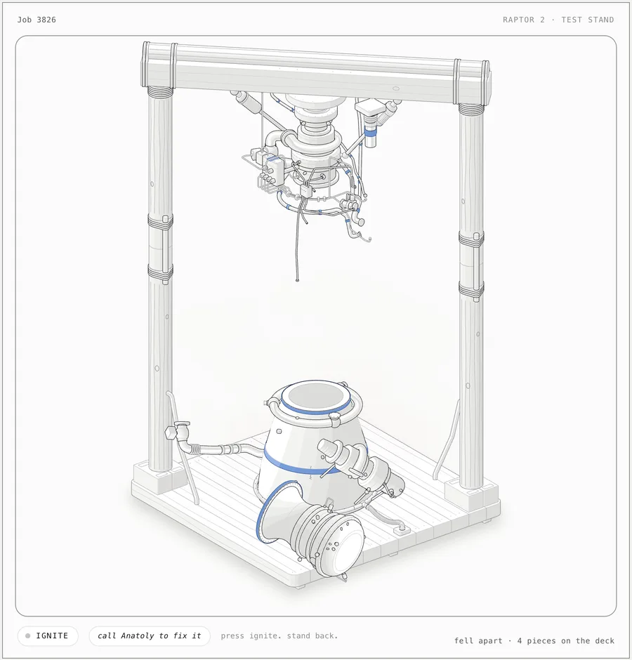

<h1 align="center">Anatoly</h1>

<p align="center"><b>An agent skill for detailed, interactive isometric machines that fall apart when you use them.</b><br>Precisely drawn, built from tape, rope and sticks. Polished SVGs with optional WebGL shaders and 3D effects.</p>

<p align="center">
  <a href="https://code.claude.com/docs/en/skills"></a>
  <a href="https://agentskills.io"></a>
  <a href="LICENSE"></a>
  <a href="#requirements"></a>
  <a href="#requirements"></a>
</p>

<p align="center">
  
</p>

<p align="center"><sub><code>examples/raptor-anatoly</code>, light theme, after one press of Ignite.</sub></p>

---

Anatoly is the plumber who installs the machines. He has had a few, he carries one roll of blue tape and a bag of fittings that are almost the right size, and he has somewhere else to be.

Ask for any machine and you get his install. The stand is fence posts on breeze blocks, the beam is a plank with a log roped on top, and the feet are bricks. The nozzle has no bolts, so it's held on with tape. Press Ignite and it works for about a second. Then it strains, the tape tears, and the engine comes down in pieces that tumble, land and tip over on the deck. Call Anatoly and he puts it back together, with more tape.

**The rule that makes it work: a precise drawing of an imprecise machine.** The machine is junk, but the drawing never is: every bodge is drawn with full craft and checked by the same geometry audit as the parts it replaces.

## Quick start

```sh
npx skills add martbln/anatoly -g -a claude-code
```

Then, in Claude Code:

```text
build an interactive isometric coffee grinder
```

You don't have to ask for broken: it's the default. For Antigravity, OpenCode or Codex, use `-a antigravity`, `-a opencode` or `-a codex`. Or clone it: `git clone https://github.com/martbln/anatoly.git ~/.claude/skills/anatoly`.

Everything is in this one repository. There is nothing else to install and nothing to `npm install`.

## Usage

| You ask for | You get |
|---|---|
| any machine: *"a steam engine I can start"* | Anatoly's install: built from junk, falls apart on every use |
| *"…subtle"* or *"…that mostly works"* | a few quiet bodges from his van; the first use works, later ones leak or slip |
| *"a clean, working figure of…"* | a plain, precise figure, no bodges |

Type `/anatoly` to call it by name. In a figure, press `R` or **call Anatoly to fix it** (shown once it's broken) to rewind the collapse and add a band of tape.

## How it works

- **[`SKILL.md`](SKILL.md)** is what the agent reads: the bodge rules, the failures and the checks. It builds on **[`ANATOMY.md`](ANATOMY.md)**, Anatomy's drawing workflow, and wins where the two disagree.
- **The bodge ledger.** Before any geometry, every defect is written down with a kind, a place and Anatoly's reason (`ledger()` in [`kit/anatoly.mjs`](kit/anatoly.mjs)). One hero bodge reads at 1×; the rest reward zooming to 4×. `--honest` builds the machine as designed.
- **Declare, don't silence.** The audit stays on. The honest build passes clean; the bodged build passes with only the exemptions its ledger declares, at rest and with every piece landed.
- **The collapse.** Each use runs one clock: works, strains, a beat, gives, settles. Pieces peel off, spin, land on a rim and tip over, a little differently each time, and the fix plays it backwards.

```text
SKILL.md                Anatoly: the rules, read first
ANATOMY.md              Anatomy's workflow and craft rules
kit/                    Anatomy's kit, plus anatoly.mjs and anatoly.css
scripts/                capture, drive, lines, audits; inline-anatoly.mjs
references/             Anatomy's references
references/anatoly/     bodges, failures, verify
examples/raptor-anatoly the Raptor above: node build.mjs [--light] [--honest] [--audit]
```

## Requirements

Claude Code (or Antigravity, OpenCode, Codex), Node.js 20.10+, and Chrome or Chromium for the visual checks. React 18+ only for React output.

## Credits

Anatoly is a fork of **[Anatomy](https://github.com/wheresryan22/anatomy)** by Ryan ([@wheresryan22](https://x.com/wheresryan22)), which does the hard part: the isometric kit, the audit, the shaders and the checks. Anatomy's other examples are still in [`examples/`](examples). For figures that work, use Anatomy.

## License

[MIT](LICENSE). © 2026 Ryan (Anatomy) and martbln (Anatoly).
